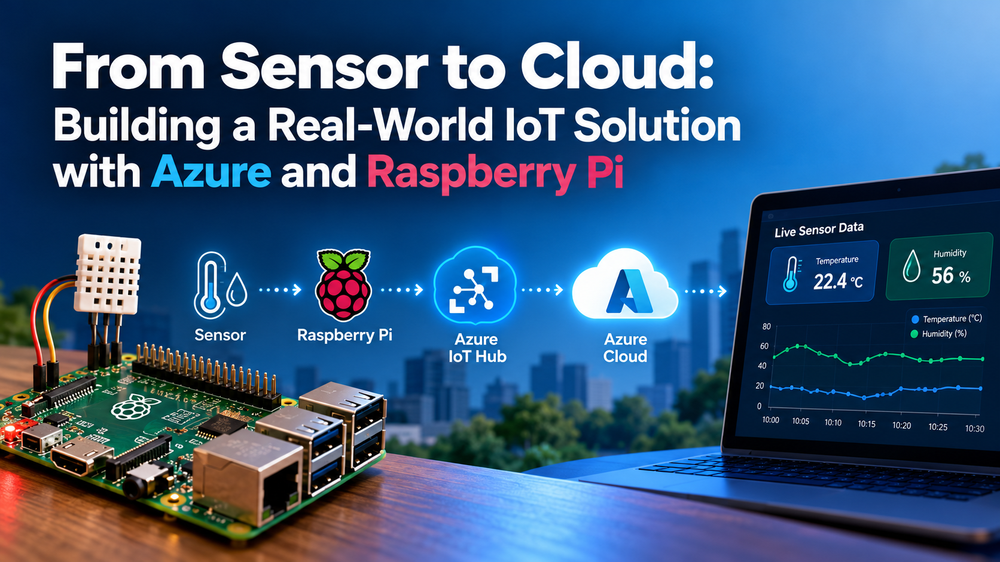

# From Sensor to Cloud: Building a Real-World IoT Solution with Azure and Raspberry Pi

## Details
From Sensor to Cloud: Building a Real-World IoT Solution with Azure and Raspberry Pi

Ready to explore the Internet of Things on Azure? Join us for a session that introduces Azure IoT and shows, step by step, how to connect a Raspberry Pi with a temperature and humidity sensor to the cloud and stream live data.

We’ll begin with the fundamentals, explain how Azure IoT Hub, devices, and cloud services fit together, and walk through a live demonstration from hardware to dashboard.

What we’ll cover:
- An introduction to Azure IoT and core concepts such as devices, telemetry, and IoT Hub
- Creating an Azure IoT Hub and registering a device using the Azure portal and Azure CLI
- Wiring a temperature and humidity sensor to a Raspberry Pi and reading sensor data
- Securely connecting the Raspberry Pi to Azure and sending live telemetry
- Monitoring incoming messages and viewing the data as it arrives in Azure
- Troubleshooting common connection problems and cleaning up Azure resources

Whether you’re new to Azure, familiar with Azure but new to IoT, or a Raspberry Pi enthusiast who wants to take your projects to the cloud, this session will give you a practical starting point.
No prior IoT experience is required. You can follow the demonstrations without an Azure subscription or a Raspberry Pi. We’ll finish with time for questions and discussion.

### YouTube
TBD<!--[TBD](https://TBD)-->

### Slides
TBD<!--[TBD.pdf](TBD.pdf)-->

### Tags
Azure 
IoT 
Raspberry Pi 
